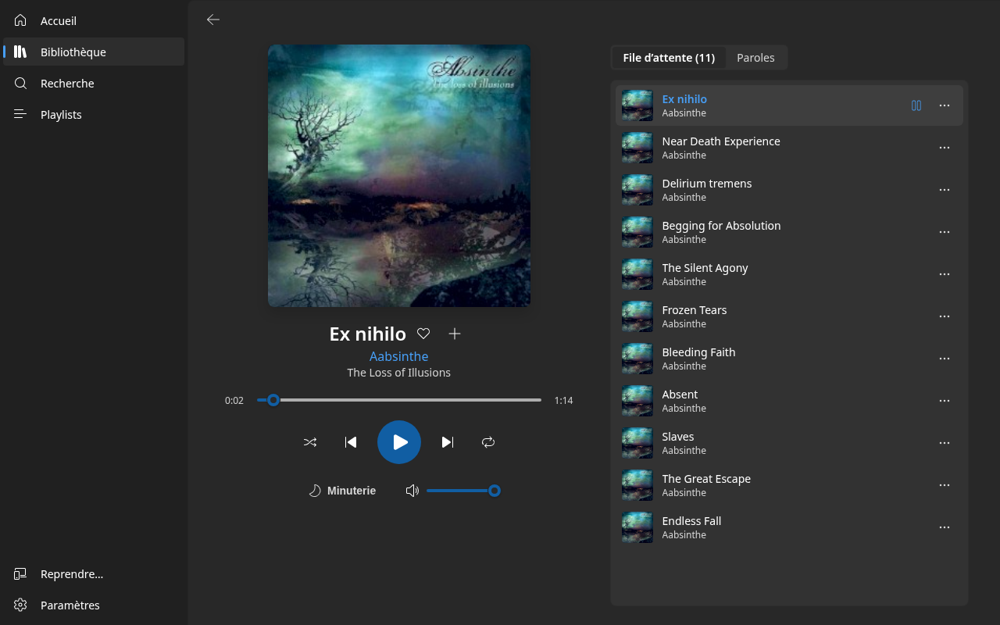
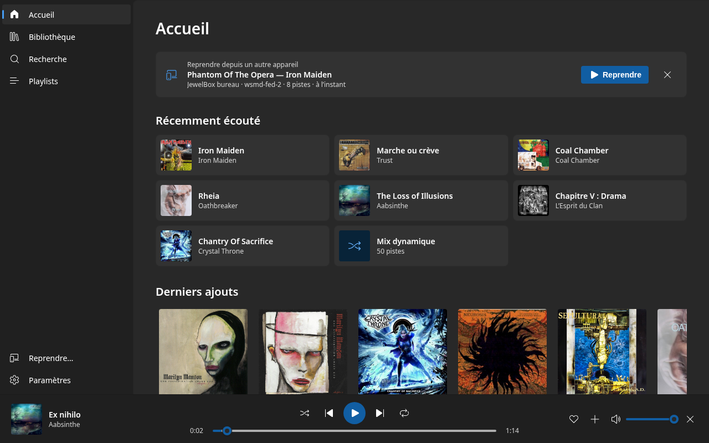
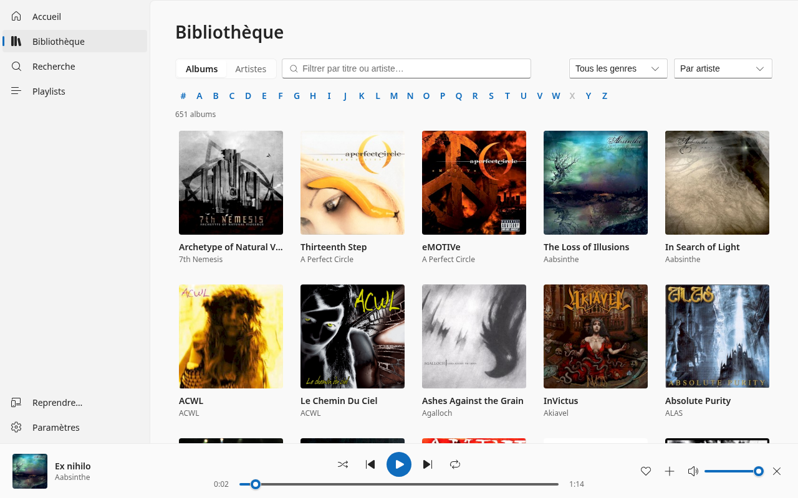
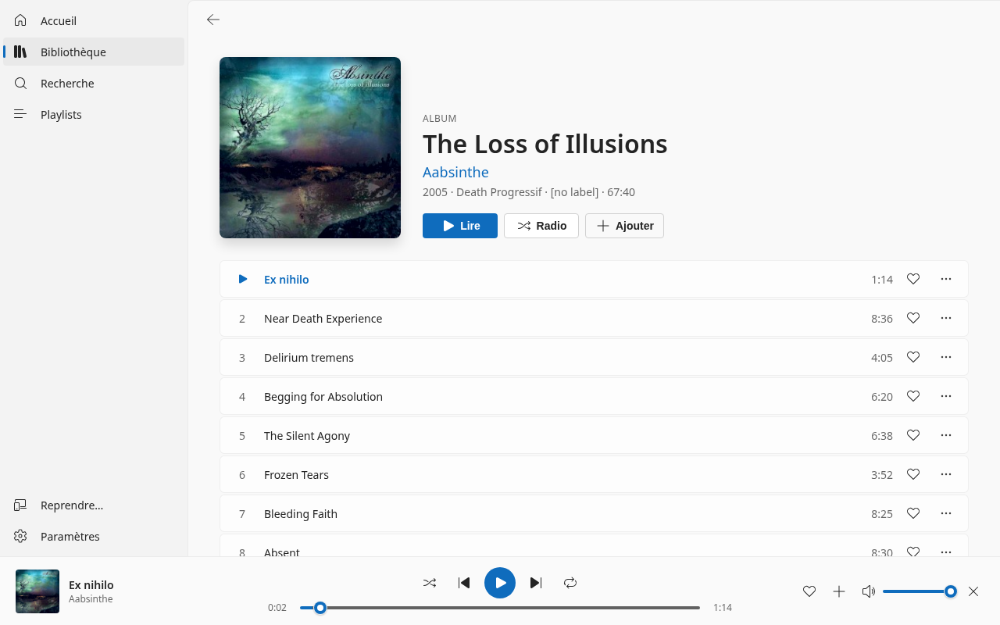

# JewelBox Music Windows Player

Client Windows 10/11 du serveur
[JewelBox Music Library](https://github.com/William-De71/Jewelbox-Music-Library).
Client **pur streaming** : aucune bibliothèque locale, tout est lu depuis le
serveur sur le réseau local. Mêmes fonctions que le
[lecteur bureau Linux](https://github.com/William-De71/JewelBox-Music-Desktop-Player),
avec l'apparence d'une application Windows 11.



| Accueil | Bibliothèque | Fiche album |
| --- | --- | --- |
|  |  |  |

Le thème clair ou sombre suit celui de Windows.

## Stack

- **Application** : [Tauri 2](https://tauri.app) (WebView2), côté natif en Rust
  (`src-tauri/`) : icône de la zone de notification, instance unique,
  notifications, taille de fenêtre mémorisée, effet Mica sous Windows 11
- **Interface** : Preact + [Fluent UI Web Components](https://github.com/microsoft/fluentui/tree/master/packages/web-components)
  et Fluent System Icons, thème clair/sombre qui suit Windows
- **Audio** : deux éléments `<audio>` en alternance (la piste suivante est
  préchargée et prend le relais) ; ReplayGain, fondu et minuteur passent par le
  volume, comme dans la PWA et l'appli Android
- **Système** : Media Session (touches multimédias, panneau multimédia de Windows)
- **Build** : Vite — **Distribution** : installateur NSIS + zip portable

Les chaînes de l'app sont en français, comme sur les autres lecteurs.

## Fonctions

Accueil (reprise depuis un autre appareil, récemment écouté, derniers ajouts,
suggestions), bibliothèque (filtre, genres, vue artistes, barre A–Z, tri),
recherche, fiches album / playlist / liste intelligente, playlists
(création, renommage, réordonnancement), mix dynamique, radio, grand lecteur
(file d'attente, paroles synchronisées, minuteur de sommeil), favoris,
lecture ensuite / ajout à la file, reprise de la file au lancement, file
partagée avec les autres appareils, contrôle à distance (Gladys), compteur
d'écoutes et Last.fm, ReplayGain, fondu entre les morceaux, lecture en
arrière-plan fenêtre fermée, raccourcis clavier.

## Développement

Prérequis : Node 24, Rust stable. Sous Fedora, pour lancer l'app en
développement :

```bash
sudo dnf install webkit2gtk4.1-devel librsvg2-devel gtk3-devel libappindicator-gtk3-devel
npm install
npm run tauri dev        # l'application (WebKitGTK sous Linux, WebView2 sous Windows)
npm run dev              # l'interface seule dans un navigateur, sur :1420
```

Tests (logique pure : client API, file, session de lecture, synchronisation,
contrôle à distance…) avec la gate de couverture (min 95 %, la même que la CI) :

```bash
npm run test:coverage
cd src-tauri && cargo test
```

L'interface se vérifie à l'œil ; le rendu final (Mica, polices Segoe UI,
contrôles multimédias) seulement sous Windows.

## Contribuer

Pas de commit direct sur `main` : une branche par fonctionnalité/correctif,
PR obligatoire. La CI exécute les tests avec gate de couverture 95 % (rapport
sur la PR), les tests Rust et construit l'installateur sur un runner Windows
(téléchargeable depuis la page du run). `./release.sh patch|minor|major` monte
la version, tague et pousse : le tag `v*.*.*` construit l'installateur et le
zip portable et les publie en release GitHub.

## Architecture

```
src/
├── main.jsx, App.jsx      # thème, volet de navigation, pile de pages
├── api/                   # client HTTP (fetch), parsing (pur)
├── core/                  # logique pure testée : file, réglages, mix,
│                          #   scrobble, synchro de file, télécommande…
├── playback/              # moteur <audio>, session, synchro, télécommande
├── app/                   # contexte, actions partagées, intégration bureau
├── pages/                 # accueil, bibliothèque, recherche, playlists…
└── ui/                    # composants (barre de lecture, menus, dialogues)
src-tauri/                 # côté natif (Rust)
```
